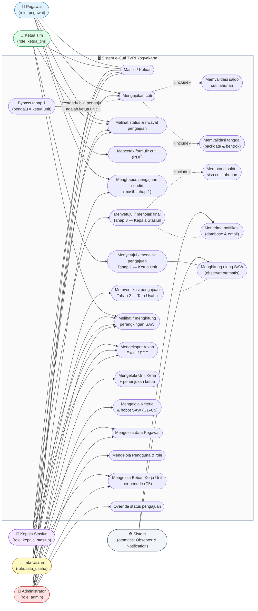

# 01 — Use Case Diagram (e-Cuti)

Diagram berikut ditulis dalam sintaks Mermaid `flowchart` (Mermaid belum punya bentuk use case bawaan — aktor diberi emoji 👤/⚙️, use case berbentuk kapsul/elips, dan batas sistem berupa `subgraph`).

Semua aktor & otorisasi diambil langsung dari kode sumber:

| Aktor (role DB) | Akses (dari kode: `canViewAny`/`canAccess`/`visible`) |
|---|---|
| Pegawai (`pegawai`) | Pengajuan sendiri, lihat status sendiri, cetak formulir, hapus pengajuan sendiri yang masih tahap 1 |
| Ketua Tim (`ketua_tim`) | Approve/tolak tahap 1 unitnya, perangkingan SAW unitnya, hapus pengajuan sendiri tahap 1 |
| Tata Usaha (`tata_usaha`) | Approve/tolak tahap 2, kelola beban kerja unit, kelola data pegawai, perangkingan SAW |
| Kepala Stasiun (`kepala_stasiun`) | Approve/tolak tahap 3 (potong saldo), perangkingan SAW |
| Admin (`admin`) | Seluruh master data (Unit Kerja, Kriteria, Pegawai, Pengguna), override status, hapus & export |

## Catatan Otorisasi (dari kodesumber)

- **Pengajuan**: dibuat oleh pemilik data (`mutateFormDataBeforeCreate` mengunci `employee_id` — non-admin selalu dirinya sendiri); Admin dapat membuatkan pengajuan atas nama pegawai mana pun.
- **Bypass tahap 1**: bila pengaju adalah ketua unit itu sendiri (`CreateCuti::mutateFormDataBeforeCreate`), pengajuan langsung memasuki tahap Tata Usaha — mencegah *self-approval*.
- **Approve tahap 1** hanya mengizinkan ketua unit yang menyetujui pengajuan **pegawai lain** (bukan pengajunya sendiri — `CutiResource::canProsesSebagaiKetua()`).
- **Tahap 3 (`UC_A3`)**: satu-satunya titik pemotongan saldo cuti tahunan, dengan transaksi + `lockForUpdate` (mencegah *overspend* saat dua proses approval berbarengan), sekaligus memicu notifikasi sukses/gagal ke pegawai.
- **Ekspor**: dari tombol pada halaman Data Pengajuan Cuti; isinya mengikuti filter & otorisasi data yang terlihat bagi peran masing-masing (pegawai hanya mencetak data sendiri).
