# 03 — Class Diagram (e-Cuti)

Diagram kelas berfokus pada **domain model + service layer** — bagian yang menangani logika bisnis aplikasi. Kelas-kelas Filament Resource memanipulasi model-model ini melalui CRUD standar, sehingga cukup digambarkan sekali di sini. Anggota `static` diberi akhiran `$` (konvensi Mermaid), sedangkan anotasi `«...»` adalah catatan perilaku khusus.

```mermaid
classDiagram
    direction LR

    %% ═══════════════ DOMAIN MODEL ═══════════════
    class User {
        <<FilamentUser>>
        +int id
        +string name
        +string email
        +string role  "admin, kepala_stasiun, tata_usaha, ketua_tim, pegawai"
        +int unit_kerja_id FK
        +string signature_image_path
        +canAccessPanel(panel) bool
        +employee() HasOne~Employee~
        +unitKerja() BelongsTo~UnitKerja~
        +booted()$ «observer: sinkron ketua/employee saat saved & deleted»
    }

    class Employee {
        +int id
        +int user_id FK
        +string nama
        +string NIP UK
        +string jabatan
        +string email
        +string telp
        +string alamat_domisili
        +int unit_kerja_id FK
        +date tanggal_bergabung
        +float nilai_kinerja  "C2 SAW (default 75)"
        +int sisa_cuti_tahunan  "C1 SAW (default 12)"
        +getMasaKerjaTahunAttribute() int  "C3 SAW (tahun penuh)"
        +cutis() HasMany~Cuti~
        +user() BelongsTo~User~
        +unitKerja() BelongsTo~UnitKerja~
        «saving: ikuti unit_kerja_id dari User»
    }

    class UnitKerja {
        +int id
        +string nama
        +int ketua_user_id FK
        +ketua() BelongsTo~User~
        +employees() HasMany~Employee~
        +bebanKerjaUnits() HasMany~BebanKerjaUnit~
    }

    class Cuti {
        +int id
        +int employee_id FK
        +string jenis_cuti
        +array tanggal_cuti_array  "tanggal terpilih (JSON)"
        +date tanggal_mulai
        +date tanggal_akhir
        +char periode  "YYYY-MM"
        +int lama_cuti
        +int urgensi  "C4 SAW (1-5)"
        +text alasan
        +string alamat_selama_cuti
        +string lampiran_link
        +string status_atasan_langsung  "pending, approved, rejected"
        +text tanggapan_atasan_langsung
        +int atasan_langsung_approver_id FK
        +string status_tata_usaha
        +text tanggapan_tata_usaha
        +int tata_usaha_approver_id FK
        +string status_kepala
        +text tanggapan_kepala
        +int kepala_stasiun_approver_id FK
        +string status_global  "alur 3 tahap + Ditolak (oleh ...)"
        +float skor_prioritas  "SAW"
        +int ranking  "SAW"
        +STATUS_MENUNGGU_ATASAN$ string
        +STATUS_MENUNGGU_TU$ string
        +STATUS_MENUNGGU_KEPALA$ string
        +STATUS_DISETUJUI$ string
        +STATUS_DITOLAK$ string
        +STATUS_PENDING$ string[]
        +STATUS_PENDING_OR_APPROVED$ string[]
        +statusDitolak(oleh)$ string
        +isDitolak() bool
        +getLamaCutiAttribute() int
        +getFormattedTanggalCutiAttribute() string
        +getStatusRekomendasiAttribute() string
        +employee() BelongsTo~Employee~
        +penilaianCutis() HasMany~PenilaianCuti~
        +atasanLangsungApprover() BelongsTo~User~
        +tataUsahaApprover() BelongsTo~User~
        +kepalaApprover() BelongsTo~User~
    }

    class Kriteria {
        +int id
        +string kode UK "C1..C5"
        +string nama_kriteria
        +TipeEnum tipe  "benefit, cost"
        +float bobot  "total = 1.0000"
    }

    class PenilaianCuti {
        +int id
        +int cuti_id FK
        +int kriteria_id FK
        +float nilai  "snapshot 10.4"
        +cuti() BelongsTo~Cuti~
        +kriteria() BelongsTo~Kriteria~
    }

    class BebanKerjaUnit {
        +int id
        +int unit_kerja_id FK
        +char periode  "YYYY-MM"
        +float nilai  "0-100, C5 SAW (cost)"
        +unitKerja() BelongsTo~UnitKerja~
    }

    %% ═══════════════ SERVICE LAYER ═══════════════
    class SawService {
        <<Service, singleton, SPK inti>>
        +calculate(nilai_alternatif, kriteria) array  "SAW murni + ranking"
        +hitungPrioritas(periode) Collection~Cuti~  "hitung & simpan snapshot + skor/ranking"
        +buildMatrix(periode) array  "matriks keputusan"
        +syncPenilaian(cuti, kriteria) void  "bulk upsert C1-C5"
        +bebanKerja(unitId, periode) float  "C5 + fallback 100"
        +validateBobot(kriteria) void  "wajib jumlah 1.0000"
        +rincian(cuti) array  "normalisasi & kontribusi per kriteria"
    }

    class CutiObserver {
        <<Observer, registrasi di AppServiceProvider>>
        +saved(cuti) void  «trigger: cuti baru / status-urgensi-tanggal/periode berubah»
        +deleted(cuti) void
        +restored(cuti) void
        +recompute(periode) void  «safe: kegagalan SAW tak memblokir simpan»
    }

    class CutiStatusUpdated {
        <<Notification, mail + database, via Queue (ShouldQueue)>>
        -Cuti cuti
        +via(notifiable) string[]
        +toDatabase(notifiable) array
        +toMail(notifiable) MailMessage
    }

    %% ═══════════════ RELASI DOMAIN ═══════════════
    User "1" --> "0..1" Employee : user_id
    UnitKerja "1" --> "0..1" User : ketua-user
    User "0..*" --> "0..1" UnitKerja : anggota-unit
    UnitKerja "1" --> "0..*" Employee : unit_kerja_id
    Employee "1" --> "0..*" Cuti : employee_id
    User "1" --> "0..*" Cuti : approver-tahap-1-2-3
    Cuti "1" --> "0..5" PenilaianCuti : snapshot
    Kriteria "1" --> "0..*" PenilaianCuti
    UnitKerja "1" --> "0..*" BebanKerjaUnit : per-periode

    %% ═══════════════ KARAJAAN SERVICE ═══════════════
    CutiObserver ..> SawService : hitung-prioritas
    SawService ..> Cuti : baca & tulis skor/ranking
    SawService ..> PenilaianCuti : upsert
    SawService ..> Kriteria : baca
    SawService ..> BebanKerjaUnit : baca
    CutiStatusUpdated ..> Cuti : detail-tanggal
    Cuti ..> CutiObserver : subject-observer

    %% ═══════════════ NOTE ═══════════════
    note for Cuti "SoftDeletes + HasFactory.\nAtribut `lama_cuti` via accessor\nbila `tanggal_cuti_array` kosong."
    note for SawService "Ranking = skor menurun,\ntie-breaker: created_at - id.\nRanking dikosongkan untuk\npengajuan yang telah diproses final."
```

## Ringkasan Kolaborasi

1. **Alur simpan**: `CreateCuti` / `CutiResource` membuat `Cuti` → `CutiObserver::saved` → `SawService::hitungPrioritas(periode)` (membuat/refresh snapshot `PenilaianCuti` C1–C5 via `syncPenilaian`, menghitung skor & ranking, lalu menulis balik ke `Cuti`).
2. **Konstanta status** di `Cuti` (`STATUS_*`) adalah satu-satunya sumber kebenaran untuk alur approval; `statusDitolak(oleh)` menyusun teks penolakan seragam.
3. **Kepala Stasiun menyetujui final** adalah satu-satunya pemindah saldo, dilakukan melalui transaksi + `lockForUpdate` di sekitar `Cuti` (lihat `docs/02-activity.md`).
4. **Pemberitahuan email** menggunakan `CutiStatusUpdated` yang mengimplementasikan `ShouldQueue` (pengiriman tak membeani request); notifikasi database Filament tetap dikirim secara sinkron.
