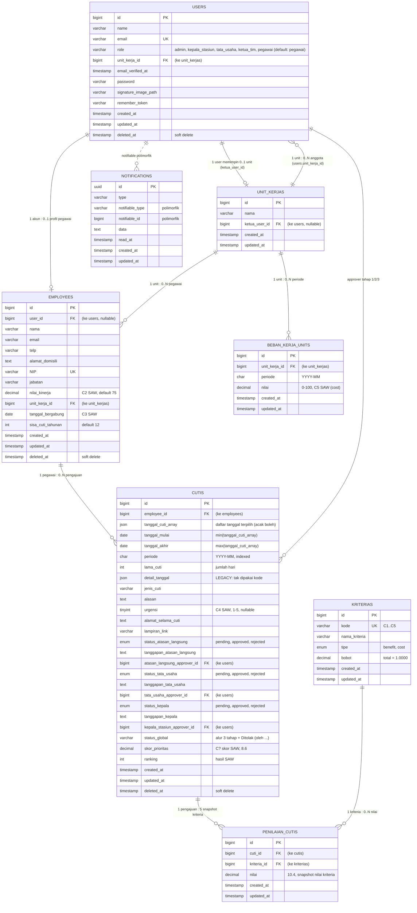

# Diagram Basis Data e-Cuti

ERD berikut disusun dari **skema database aktif** (diekspor langsung dari MySQL, termasuk seluruh riwayat migrasi). Diagram dirender dengan [Mermaid](https://mermaid.js.org/) — di GitHub cukup buka file ini untuk melihat gambar ERD.

## ERD



## Ringkasan Relasi App-Level (Eloquent)

| Model | Relasi | Keterangan |
|-------|--------|------------|
| `User` | `employee` (HasOne) | Profil pegawai penautan akun; `null` artinya akun non-pegawai |
| `Employee` | `user` (BelongsTo), `unitKerja` (BelongsTo), `cutis` (HasMany) | Sumber C1, C2, C3 |
| `UnitKerja` | `ketua` (BelongsTo → User), `employees` (HasMany), `bebanKerjaUnits` (HasMany) | Ketua = approver tahap 1 |
| `Cuti` | `employee`, `atasanLangsungApprover`, `tataUsahaApprover`, `kepalaApprover` (BelongsTo → User), `penilaianCutis` (HasMany) | Approver disimpan per tahap |
| `PenilaianCuti` | `cuti` (BelongsTo), `kriteria` (BelongsTo) | Unique `(cuti_id, kriteria_id)` — matriks keputusan SAW |
| `BebanKerjaUnit` | `unitKerja` (BelongsTo) | Unique `(unit_kerja_id, periode)` — sumber C5 |
| `Notification` | polimorfik (`notifiable`) | Bells/UI notifikasi; penerima bisa User maupun Employee |

## Catatan Desain

- **Referensi silang Users ⇄ UnitKerjas**: `users.unit_kerja_id → unit_kerjas` dan `unit_kerjas.ketua_user_id → users`. Keduanya nullable + `nullOnDelete`, dan penunjukan ketua hanya dikelola lewat observer pada `App\Models\User` (penggantian role/ketua mereset `ketua_user_id` lama).
- **`status_global`**: string gerbang alur (`Menunggu Persetujuan Atasan Langsung`, `... Tata Usaha`, `... Kepala`, `Disetujui`, `Ditolak (oleh <penyetuju>)`). Penyebut penolakan ikut tersimpan sehingga riwayat alur tercatat; filter memakai pencocokan awalan `Ditolak`. Konsumsi status cukup lewat konstanta `App\Models\Cuti::STATUS_*`.
- **`cutis.detail_tanggal`** adalah kolom *legacy* dari versi awal pemilih tanggal — semua kode kini memakai `tanggal_cuti_array`; kolom ini boleh dibuang di migrasi pembersihan berikutnya.
- **Kolom SAW** (`skor_prioritas`, `ranking`) hanya terisi bila pengajuan masih pending pada periode aktif; langsung dinull-kan setelah keputusan final.
- **Saldo cuti** (`employees.sisa_cuti_tahunan`) dipotong saat approval tahap 3 (final) dan dikembalikan bila pengajuan disetujui dihapus — selalu dalam transaksi + `lockForUpdate`.

## Menjalankan Migrasi dari 0

```bash
php artisan migrate --seed     # + seeder akun demo & kriteria SAW
php artisan db:seed --class=SawDemoSeeder   # data demo perangkingan (opsional)
```
